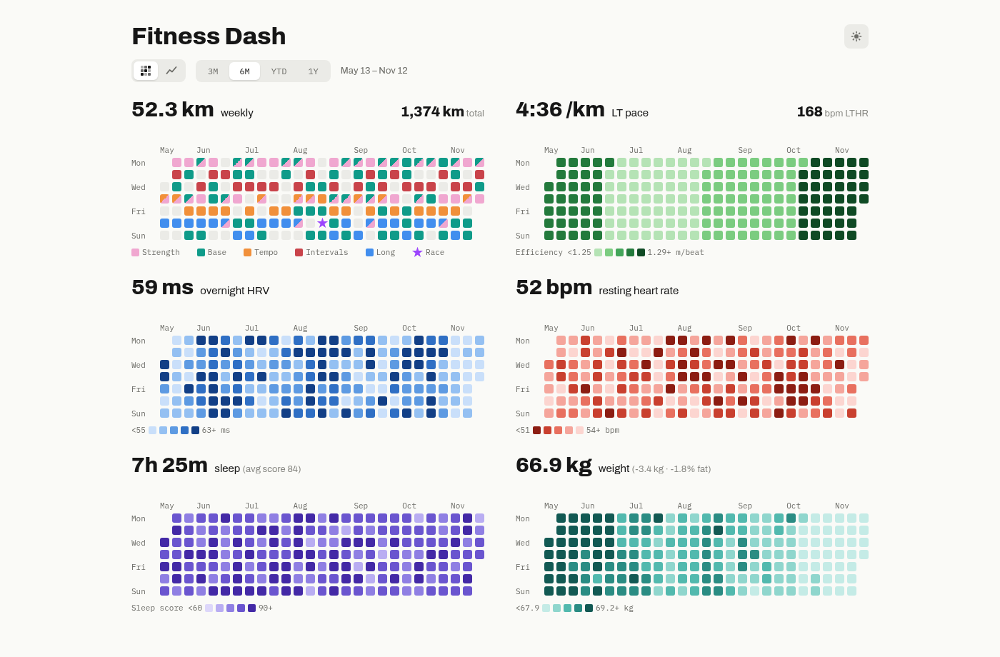
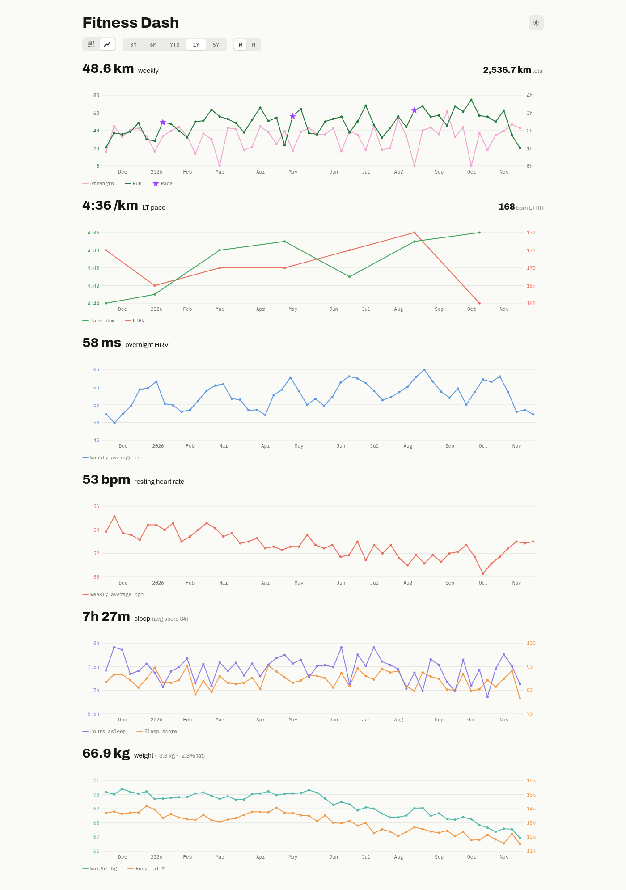
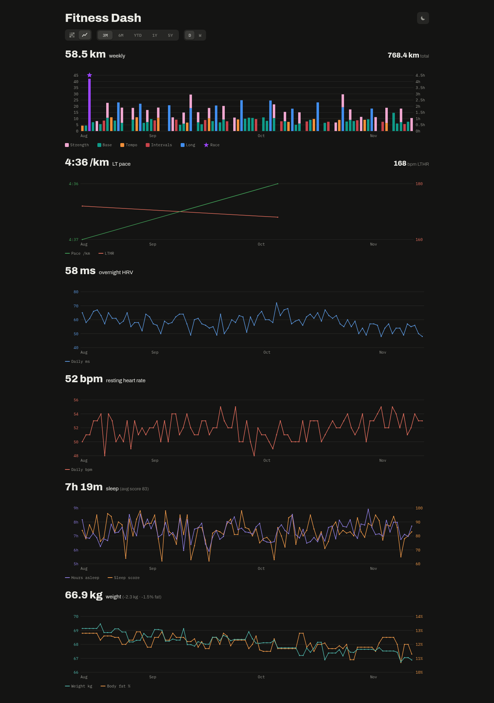

# Fitness Dash

A self-hosted dashboard for your Garmin Connect data: running, strength training, lactate threshold, HRV, resting heart rate, sleep and weight, as GitHub-style heatmaps or line charts.



<p>
  
  
</p>

The screenshots show made-up data from `docs/demo_data.py`.

## How it works

```
Garmin Connect ──► sync ──► garmin_cache.json ──► api ──► browser (web/)
```

| Part | What it does |
|---|---|
| **Sync** (`sync/`) | Downloads the last five years from the Garmin Connect Personal API into `garmin_cache.json`, then exits. Later runs only fetch new days (plus the last two, which Garmin may still be updating). Run it on a schedule. |
| **API** (`api/`) | Reads the cache and serves per-day metrics as JSON, plus the frontend. |
| **Frontend** (`web/`) | Plain HTML, CSS and JavaScript that draws the charts in the browser. |

Everything uses only the Python standard library and plain browser JavaScript: no database, framework or build step.

## What it shows

| Panel | Heatmap | Line chart |
|---|---|---|
| **Running** | Each day coloured by run type, strength days marked, races as stars | Distance and strength hours; at daily points, runs are stacked columns by type |
| **Lactate threshold** | Efficiency at threshold (metres per heartbeat) | Threshold pace and heart rate |
| **HRV** | Overnight average | Overnight average |
| **Resting HR** | Resting heart rate | Resting heart rate |
| **Sleep** | Sleep score | Hours asleep and sleep score |
| **Weight** | Latest weigh-in, carried over days without one | Weight and body fat % |

- **Ranges:** 3M, 6M, YTD, 1Y and 5Y (line charts only), each ending today.
- **Line chart points:** daily, weekly, monthly or yearly, depending on the range.
- **Hover or tap** a point to see that day, week or month in every chart. Click to pin it.
- **Units** (metric or imperial) follow your Garmin profile.
- **Light and dark themes**, following your device until you pick one.
- **The URL keeps the current view**, so you can bookmark it.

### Run types

Each run is classified from its Garmin summary, checking these in order:

1. **Long:** 12 km or more, and at least 65% of your longest run in the previous 28 days.
2. **Intervals:** a workout with rest splits that reached HR zone 4, or a structured workout with at least 20% of its time in zones 4–5.
3. **Tempo:** at least half the time in zones 3–5.
4. **Base:** everything else.

The thresholds are at the top of `api/metrics.py`.

### Lactate threshold

Garmin's API doesn't provide lactate threshold history, so you keep it in `lactate_threshold.csv`, adding a row whenever it changes:

```csv
date,heart_rate,pace
2026-01-05,168,4:45
2026-02-20,166,4:40
```

Pace is minutes:seconds per km. Each row applies from its date until the next one. Without the file, the panel is hidden. Changes are picked up without a restart.

## Running locally

You need Python 3.9 or later; there's nothing to install. Run from the repo root:

```sh
export GARMIN_PERSONAL_API_KEY=...
python3 -m sync                  # download into garmin_cache.json (the first run takes a few minutes)
python3 -m api --static web      # open http://127.0.0.1:8081
```

Run `python3 -m sync` again for fresh data. If `GARMIN_PERSONAL_API_KEY` isn't set, sync reads it from the `garmin-key` Kubernetes secret using your current `kubectl` context.

To try it without a Garmin account, use made-up data:

```sh
python3 docs/demo_data.py demo
python3 -m api --cache demo/garmin_cache.json --lactate-threshold demo/lactate_threshold.csv --static web
```

Other options:

- `python3 -m sync --refetch-activities START [END]` downloads those days' activities again, e.g. after editing one in Garmin Connect.
- To download everything again, delete `garmin_cache.json`.
- `python3 -m api --help` lists the API's flags (cache and CSV paths, host, port).

Tests: `python3 -m unittest discover -s tests -t .`

### Where to change things

| To change… | Edit |
|---|---|
| What's fetched from Garmin | `sync/client.py`, and `KEEP` in `sync/cache.py` |
| Metrics, units and run-type rules | `api/metrics.py` |
| Ranges, colours and chart sizes | `web/js/config.js` |
| Panel headlines and tooltips | `web/js/panels.js` |
| Look and layout | `web/css/` |

## Example deployment

Anything that runs `python3 -m sync` on a schedule and keeps `python3 -m api --static web` running will work, such as a cron job and a service on one machine. The dashboard has no login of its own.

This repo includes one way to do it, on Kubernetes: a single pod that runs sync every hour in the background and serves the dashboard on port 8080, with the cache and threshold CSV on a persistent volume.

### Setup

1. Create the API key secret:

   ```sh
   kubectl -n default create secret generic garmin-key --from-literal=GARMIN_KEY=<personal-api-key>
   ```

2. Deploy:

   ```sh
   ./deploy.sh                          # uses your current kubectl context
   ./deploy.sh --context my-cluster     # or pass any kubectl arguments
   ```

   This uploads the code as ConfigMaps, applies `k8s/garmin-dash.yaml` (a volume, the Deployment and a Service on port 80), applies any gitignored `k8s/*.local.yaml` files, and restarts the pod.

The volume needs a default StorageClass. Since a ReadWriteOnce volume attaches to one node at a time, the old pod stops before the new one starts, so a deploy is down for a few seconds; on a ReadWriteMany volume such as NFS you can switch to a rolling update (see the comment in the manifest). The manifests don't expose the Service outside the cluster.

### Operating it

```sh
kubectl logs deploy/garmin-dash -f                                                   # sync progress and errors
kubectl exec deploy/garmin-dash -- python -m sync --cache /data/garmin_cache.json    # sync now
kubectl exec deploy/garmin-dash -- rm /data/garmin_cache.json                         # download everything again on the next sync
kubectl cp lactate_threshold.csv "$(kubectl get pod -l app=garmin-dash -o name | head -1 | cut -d/ -f2)":/data/lactate_threshold.csv   # upload the threshold CSV
```

To change how often it syncs, edit `REFRESH_SECONDS` in `k8s/garmin-dash.yaml`.

## License

[MIT](LICENSE)
